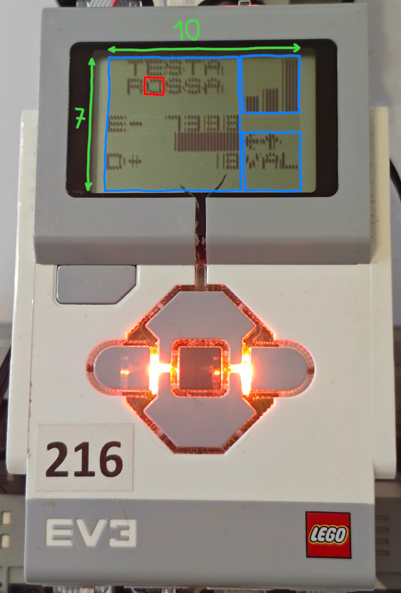

Who am I
---

<!-- pause -->
##### **a passionate software engineer**
<!-- pause -->
##### *things I worked on*
<!-- pause -->
#### telecom switching stations
<!-- pause -->
#### JIT compilers
#### (Mono project, then V8 in Google)
<!-- pause -->
#### gaming engines (Unity 3D)
<!-- pause -->
##### interactive, collaborative VR
<!-- pause -->
#### 🦀 distributed systems and blockchains 🦀
<!-- pause -->
#### 🦀 operational research (vehicle routing) 🦀

---

That was me, Professionally
---

<!-- pause -->
##### *Who am I, for this talk?*

<!-- pause -->
##### 🤖 Robotic Competitions as a Hobby 🎉

<!-- pause -->


##### ItLUG Robotics Team

---

Talk Outline
---

<!-- pause -->
##### Lego LIne Follower 🤖 Robots, and 🦀 Rust

<!-- pause -->
#### 🤖          Line Follower Robots          🤖
#### 🤖             PID controller             🤖
<!-- pause -->
#### 🦀      embedded Rust on a EV3 brick      🦀
#### 🦀       wrapping an embedded C SDK       🦀
<!-- pause -->
#### 🤖           the need for async           🤖
#### 🦀         a custom async runtime         🦀
<!-- pause -->
#### 🦀              embedded GUI              🦀
<!-- pause -->
#### 🤖         the need for telemetry         🤖
#### 🦀    telemetry and data visualization    🦀
<!-- pause -->
##### 🤖   advanced line following techniques   🤖

<!-- pause -->
##### these are **two** *talks* in **one**!
<!-- pause -->
##### let's go **full** *speed* and *hope* for the **best!**

---

Talk Progress
---

```rust {2}

 line_followers() & PID::controllers;
 
 embedded_rust + Lego::EV3::Brick;
 
 why_async() & custom::Async::runtime();
 
 embedded * GUI;
 
 Telemetry;
 
 line_follower(control + algorithms) -> Advanced;

```

---

🤖 Line Follower Robots 🤖
---

##### there are...

<!-- pause -->
#### 🏎️💨 fast ones 🏎️💨
<!-- pause -->
#### 6㎧ on straight lines
##### 💥 engineering marvels 💥

<!-- pause -->
#### 🤖 Lego ones 🤖
<!-- pause -->
#### 🐌 much slower 🐌
#### 1㎧ overall speed
<!-- pause -->
#### 🤔 different challenges 🤔

---

A Toy Line Follower
---

<!-- pause -->
#### use only two sensors
##### ⬅ **left** and **right** ➡
<!-- pause -->
#### if one **side** *senses* the **line**,
##### **turn** that *way*
<!-- pause -->
##### *otherwise*, go **straight**

<!-- pause -->
#### **LET'S SEE**

---

Can we do better?
---

<!-- pause -->
##### this *robot* is **"binary"**
<!-- pause -->
##### it does *not* have **proportional** reactions
<!-- pause -->
##### *how* can we **improve** it?

---

Analog Sensors
---

<!-- pause -->
#### set them up to *sense* the **line**
##### *position* **gradually**

<!-- pause -->
#### 😮 **sub millimeter** *accuracy* 😮

---

Fixed Point Math
---

<!-- pause -->
#### the *EV3* **CPU** does **not** have a
##### **Floating Point** *Unit*

<!-- pause -->
##### fixed-point math to the rescue!

<!-- pause -->
##### time: **`㎲`**

<!-- pause -->
#### distance: **`㎜`**
##### *(error in **`㎛`**)*

<!-- pause -->
#### speed: **`㎜/s`**
##### *(same as **`㎛/㎳`**)*

<!-- pause -->
#### **wheel** *rotation speed*
##### in **`㎛/㎲`!**


---

🤖 Use a 🅿 🅸 🅳 Controller 🤖
---

<!-- pause -->
##### What is it?

<!-- pause -->
```
🅿 Proportional
🅸 Integral
🅳 Derivative
```

<!-- pause -->
#### given the error ⓔ
#### *(the distance from the line)*
<!-- pause -->
##### and three constants: `ₖ🄿 ` `ₖ🄸 ` `ₖ🄳 `

<!-- pause -->
##### `turn` = ⓔ ×`ₖ🄿 ` + (∫ⓔ dt)×`ₖ🄸 ` + (dⓔ /dt)×`ₖ🄳 `

<!-- pause -->
#### *this should give **smooth** trajectory control*
##### ***if** the constans are **tuned** properly*

---

🤖 Understanding a 🅿 🅸 🅳 Controller 🤖
---

<!-- column_layout: [1, 1] -->
<!-- column: 0 -->

<!-- column: 1 -->
##### *proportional*

<!-- pause -->
#### 🔵
##### robot speed

<!-- pause -->
#### 🔴
##### distance from line

<!-- pause -->
#### 🟢
##### desired turn

##### `turn` = ⓔ ×`ₖ🄿 `

---

🤖 Understanding a 🅿 🅸 🅳 Controller 🤖
---

<!-- column_layout: [1, 1] -->
<!-- column: 0 -->

<!-- column: 1 -->
##### *derivative*

<!-- pause -->
#### 🔵
##### robot rotation

<!-- pause -->
#### 🔴
##### apparent line side speed

<!-- pause -->
#### 🟢
##### desired compensation

##### `turn` = (dⓔ /dt)×`ₖ🄳 `

---

🤖 Understanding a 🅿 🅸 🅳 Controller 🤖
---

<!-- column_layout: [1, 1] -->
<!-- column: 0 -->

<!-- column: 1 -->
##### *integral*

<!-- pause -->
#### 🔵
##### robot rotation

<!-- pause -->
#### 🔴
##### line distance over time

<!-- pause -->
#### 🟢
##### desired turn

##### `turn` = (∫ⓔ dt)×`ₖ🄸 `

---

🤖 Understanding a 🅿 🅸 🅳 Controller 🤖
---

<!-- column_layout: [1, 1, 1] -->
<!-- column: 0 -->
##### *proportional*
##### `turn` = ⓔ ×`ₖ🄿 `

#### *considers*
#### **now**
<!-- column: 1 -->
##### *derivative*
##### `turn` = (dⓔ /dt)×`ₖ🄳 `

#### *predicts*
#### the **future**
<!-- column: 2 -->
##### *integral*
##### `turn` = (∫ⓔ dt)×`ₖ🄸 `

#### takes the **past**
#### into *account*

---

BUT WAIT
---

<!-- pause -->
##### 🦀 What About Rust? 🦀
<!-- pause -->
#### we have been talking about
#### *line follower* **robots** and
##### *trajectory control* **algorithms**
<!-- pause -->
##### 🤔 *isn't this a **Rust** conference?* 🤔

---

Talk Progress
---

```rust {2|4}

 line_followers() & PID::controllers;
 
 embedded_rust + Lego::EV3::Brick;
 
 why_async() & custom::Async::runtime();
 
 embedded * GUI;
 
 Telemetry;
 
 line_follower(control + algorithms) -> Advanced;

```

---

🦀 Why Rust... 🦀
---

<!-- pause -->
##### ...in a 🔧 hobby 🤖 robotic project?
<!-- pause -->
##### to *learn* 🧠 the **language**
<!-- pause -->
##### to *avoid* 🐞 **bugs**
<!-- pause -->
##### *because* it is 🎉 **possible!**

---

🦀 Rust on a EV3 🤖
---

<!-- pause -->
#### original firmware
##### *(let's skip this)*

<!-- pause -->
##### `ev3dev` (a Debian port)
<!-- pause -->
#### extremely **flexible**, but with
#### unpredictable **latency**
##### *up to 20㎳*

<!-- pause -->
#### 🤔 *why* is latency an **issue** ❓

---

🤖 Hard Real Time 🤖
---

<!-- pause -->
##### the **PID** runs in an *event loop*
<!-- pause -->
##### a *late* result is a **wrong** result
<!-- pause -->
##### 🤔 how *fast* is **fast enough?** 🤔
<!-- pause -->
#### ⛔ *not* ⛔
##### as *fast* as **possible**
<!-- pause -->
#### ✅ *but* ✅
##### as *fast* as **needed**

---

Line Follower Latency
---


<!-- pause -->
#### bot speed:
#### 1.0㎧: 2㎳ ➡ 2㎜
#### 1.5㎧: 2㎳ ➡ 3㎜
##### 2.0㎧: 2㎳ ➡ 4㎜

<!-- pause -->
#### line *width*: **20㎜**
#### max *sensing period*: about **4㎳**

---

Enter EV3RT
---

<!-- pause -->
#### a *port* of **TOPPERS HRP2**
##### *an industrial Real Time OS*
<!-- pause -->
##### 💥 Open Source 💥
<!-- pause -->
##### *docs* and *comments* in 🇯🇵 **Japanese** 😮

<!-- pause -->
#### 😄 with a usable C SDK 👍

---

🦀 Rust on EV3RT 💻
---

<!-- pause -->
##### *wrapping* the **C API** is easy
<!-- pause -->
#### just *declare* all **C external** *functions*
##### and **wrap** them with *safe Rust* ones
<!-- pause -->
##### EV3RT has a *dynamic* program **loader**
<!-- pause -->
##### *programs* are "plain" **ELF files**
<!-- pause -->
##### the *linker* script is **crazy**

---

EV3RT 🤖 Rust 🦀 Linking 🔗 Recipe
---

<!-- pause -->
#### compile a sample EV3RT C app
#### with a trivial `main()`
##### and keep all the `.o` files
<!-- pause -->
#### compile Rust code to a static lib (`.a`)
##### that implements the `main()` function
<!-- pause -->
#### replace the C `.o` file providing **`main`**
##### with the Rust `.a` library
<!-- pause -->
#### use the **original** EV3RT **linker script**
##### to produce the loadable app

<!-- pause -->
##### **😄...PROFIT! 😄**

---

💻 EV3RT 🦀 Rust `API` 💻
---

<!-- pause -->
##### *simple*, **imperative** low-level **API**
<!-- pause -->
#### access *every* **EV3 port**
##### support *every* **sensor** and **motor**
<!-- pause -->
##### get **time** (㎲) and **sleep** (㎳)

<!-- pause -->
##### **OS** *latency* is **sub ㎳**

<!-- pause -->
#### also provides *simplified* interfaces
##### to **file** system and **Bluetooth** serial

<!-- pause -->
#### *usable*, but **not enough**

---

API for Arduino-style Coding
---

<!-- pause -->
##### *full* logic in a **single** *event* **loop**

<!-- pause -->
```rust {1,5|2|3|4|all}
loop {
    read_sensors()
    compute_something()
    apply_results()
}
```
<!-- pause -->
##### 🤔 *what's **wrong** with it?* 🤔

<!-- pause -->
##### **nothing!** *but...*

---

Talk Progress
---

```rust {4|6}

 line_followers() & PID::controllers;
 
 embedded_rust + Lego::EV3::Brick;
 
 why_async() & custom::Async::runtime();
 
 embedded * GUI;
 
 Telemetry;
 
 line_follower(control + algorithms) -> Advanced;

```

---

The Need for `async`
---

<!-- pause -->
##### CONCURRENT SENSOR READS

<!-- pause -->
##### sensors *read* rate **mismatches**
#### NXT analog:  **3㎳**
#### Ultrasound: **20㎳**
##### RGB color:  **1㎳**

<!-- pause -->
#### a logic *loop* should read **concurrently**
<!-- pause -->
#### *RGB* color data every **1ms**
<!-- pause -->
##### *Ultrasound* updates every **20㎳**

<!-- pause -->
#### *(not really in this robot)*

---

The Need for `async`
---

##### CONCURRENT LOGIC

<!-- pause -->
#### robot *logic* can be composed of
#### different **concurrent** state machines
##### *(different **tasks** progressing at different **rates**)*

<!-- pause -->
#### process **line error**
##### *(dⓔ /dt, ∫ⓔ dt, filtering)*

<!-- pause -->
#### process **motor status**
##### *(compute actual wheels speed)*

<!-- pause -->
##### run **driving logic**

<!-- pause -->
##### collect **telemetry**

<!-- pause -->
##### handle **screen** and **input** buttons

---

EV3RT API Mismatch
---

<!-- pause -->
##### the *EV3RT API* is **synchronous**
<!-- pause -->
##### it does **not** expose *interrupts*
<!-- pause -->
#### **tasks** are *cumbersome* to use
##### *(no channels)*
<!-- pause -->
##### it's *like* ⬜ **squaring** a ⚪ **circle**

<!-- pause -->
##### but *remember*: **1㎳** latency is **fine**

---

💡 Idea: a Dumb `async` Runtime 💡
---

<!-- pause -->
#### **EV3RT** does **not** expose **interrupts**
<!-- pause -->
#### but it *reads* sensors **concurrently** *internally*
##### *(and provides their **values** in a **shared RAM** area)*

<!-- pause -->
#### run an **event loop** collecting
#### all **data** from *pending reads*
##### *(sleeping **1㎳** at every iteration)*

<!-- pause -->
##### implement `Future` values with **no** *waker*

<!-- pause -->
##### implement `poll` checking for **new** *data*

<!-- pause -->
#### **compose** `Future`s with *usual combinators*
##### *(`zip` or `join`, `select`...)*

<!-- pause -->
#### **each** event loop *iteration*
#### **`poll`s** the *root* `Future`
##### *(this kicks all tasks into making progress)*

---

🦀 `async` Event Loop 🦀
---

```rust {all|1|2-3|6-11|6|7-9|10-11}
pub fn run(self, root_task: mut PinBoxed<impl Future<Output = ()>>) {
    let waker = noop_waker();
    let mut context = core::task::Context::from_waker(&waker);

    loop {
        self.ev3.update();
        if root_task.as_mut().poll(&mut context) == core::task::Poll::Ready(()) {
            break;
        }
        self.ev3.apply();
        ev3rt::msleep(1);
    }
    ev3rt::reset(false);
}
```

---

🦀 `async` Boilerplate 🦀
---

```rust {all|1,2,6|5-6,9-11|3,14-16}
fn no_op(_: *const ()) {}
fn no_op_clone(_: *const ()) -> core::task::RawWaker {
    noop_raw_waker()
}
static RWVT: core::task::RawWakerVTable =
    core::task::RawWakerVTable::new(no_op_clone, no_op, no_op, no_op);

#[inline]
fn noop_raw_waker() -> core::task::RawWaker {
    core::task::RawWaker::new(core::ptr::null(), &RWVT)
}

#[inline]
fn noop_waker() -> core::task::Waker {
    unsafe { core::task::Waker::from_raw(noop_raw_waker()) }
}
```

---

🦀 A `root_task` function, `async` style 🦀
---

```rust {all|1|2-3|5-7|10-13|9,14,15}
async fn root_task<EV3: Ev3Brick>(ev3: EV3) {
    ev3.init();
    ev3.setup().await;

    let error = ErrorTask::new();
    let motors = MotorsTask::new();
    let telemetry = TelemetryTask::new();

    zip!(
        error.run(&ev3),
        screens(&ev3, &error, &motors, &telemetry),
        motors.run(&ev3),
        telemetry.run(&ev3, &error, &motors)
    )
    .await;
}
```

---

🦀 The full `main` function 🦀
---

```rust {all|4|5|6}
static FONT: Font<LcdTopSideUp> = build_font::<LcdTopSideUp>();
#[no_mangle]
pub extern "C" fn main() {
    let ev3 = Ev3::new(&FONT, Duration::from_ms(25));
    let future = root_task(ev3.clone());
    ev3.run(pin_boxed(future));
}
```

<!-- pause -->
##### *pinning boilerplate*

```rust
pub type PinBoxed<T> = core::pin::Pin<alloc::boxed::Box<T>>;
pub fn pin_boxed<T>(t: T) -> PinBoxed<T> {
    alloc::boxed::Box::pin(t)
}
```

##### *(`alloc` is fine, we have **64 MB** of **RAM**)*

---

🦀 Inner Event Loop Details 🦀
---

```rust
loop {
    self.ev3.update();
    if future.as_mut().poll(&mut context) == core::task::Poll::Ready(()) {
        break;
    }
    self.ev3.apply();
    ev3rt::msleep(1);
}
```

<!-- pause -->
#### `ev3` has the **full** *hardware* **state** but it is **not** `mut`
##### *its reference is shared with all tasks*

<!-- pause -->
#### *every* atomic piece of **data** in **EV3** is *enclosed* in a `Cell`
##### **OK**, because the *executor* is **single-threaded**

<!-- pause -->
##### *every* sensor `Future` **refers** to a `Cell`:
<!-- pause -->
#### it can *provide* the **current** value immediately
<!-- pause -->
#### it supports `.await` for the **next value**
<!-- pause -->
#### it can provide a `Stream` of **future values**


---

So far, so good
---

<!-- pause -->
##### *...but...*

<!-- pause -->
#### how do we *interact*
##### with the **robot**?

<!-- pause -->
#### how do we *inspect*
##### what the **robot** is **doing**?

---

Talk Progress
---

```rust {6|8}

 line_followers() & PID::controllers;
 
 embedded_rust + Lego::EV3::Brick;
 
 why_async() & custom::Async::runtime();
 
 embedded * GUI;
 
 Telemetry;
 
 line_follower(control + algorithms) -> Advanced;

```

---

We Need a UI
---

<!-- pause -->
##### Having a **UI** for the robot is **useful!**

<!-- pause -->

##### it *looks* like **this**

---

🦀 The Fast UI Challenge 🦀
---

<!-- pause -->
##### the **EV3** *screen*

<!-- pause -->
##### resolution is **small** *(178×128)*

<!-- pause -->
#### framebuffer memory *layout* is **crazy**
#### monochrome, **2 bits** per *pixel*, **3 pixels** per *byte*
<!-- pause -->
##### not so big (total size **7680 bytes**), but...

<!-- pause -->
##### ...a **full** screen *render* is insanely **slow**

<!-- pause -->
##### *and latency is bad, right?*

---

Graphical Requirements
---

<!-- pause -->
##### writing text, numbers and symbols

<!-- pause -->
##### statically pick a screen orientation

<!-- pause -->
##### should be easy to read "in action"

<!-- pause -->
##### drowing real time bar charts

---

Idea: a Character Based UI
---

<!-- column_layout: [2, 3] -->
<!-- column: 0 -->


<!-- column: 1 -->
<!-- pause -->
#### 🔴 a **18×18** square *font* 🔴
#### is **big** and **readable**
<!-- pause -->
#### can be *easily* **rotated**
<!-- pause -->
##### does *not* **cross** *bytes*

<!-- pause -->
##### 🟢 the *screen* fits **10×7 chars** 🟢
<!-- pause -->
#### 🔵 divided in three square regions 🔵
##### (1 main **7×7**, 2 secondary **3×3**)
<!-- pause -->
##### *again, easy to rotate*

---

Fast Screen Refresh
---

<!-- pause -->
#### a **full** frame *buffer* now is **10×7** = **70** bytes
#### **double** *buffering* becomes **feasible**
##### *(the problem was **speed** and not **memory**)*
<!-- pause -->
#### a *diff* between two screens is almost **instant**
##### we can *redrow* only **changed** characters
<!-- pause -->
##### drowing each *character* is a **54 bytes** write
<!-- pause -->
##### *redrows* are limited to a **fixed framerate**
<!-- pause -->
##### *(refreshing every 25㎳ is fine)*

<!-- pause -->
##### **we'll see it in action at the end!**

<!-- pause -->
##### *what's missing?*

---

Talk Progress
---

```rust {8|10}

 line_followers() & PID::controllers;
 
 embedded_rust + Lego::EV3::Brick;
 
 why_async() & custom::Async::runtime();
 
 embedded * GUI;
 
 Telemetry;
 
 line_follower(control + algorithms) -> Advanced;

```

---

Understanding What Goes Wrong
---

<!-- pause -->
##### from **UI**
##### to **TELEMETRY**

---

Understanding What Goes Wrong
---

<!-- pause -->
#### having a **UI** is *fine*
##### but we **cannot** use it while the *robot* **races**

<!-- pause -->
#### **filming** the *robot* while it runs is **fine**
##### but it does **not** show what *happens* **inside**

<!-- pause -->
#### we **need** a *telemetry* **system**

---

What Do We Need?
---

<!-- pause -->
##### we would like to inspect:

<!-- pause -->
#### timestamps `㎲`
<!-- pause -->
#### line error `ⓔ`
<!-- pause -->
#### error derivative `dⓔ /dt`
<!-- pause -->
#### gyro `deg/s`
<!-- pause -->
#### left and right wheel speed `㎜/s`
<!-- pause -->
#### left and right motor power `PWM`
<!-- pause -->
#### left, center, right sensor `flags`
<!-- pause -->
#### out condition `direction`
<!-- pause -->
##### overall distance `㎜`

<!-- pause -->
#### *each sample*
#### *fits in 20 bytes*


---

The Telemetry Challenge
---

<!-- pause -->
#### we want to *see* **every** decision **taken**
##### *(a 20 bytes sample)*
<!-- pause -->
##### potentially at a **1㎑** rate
<!-- pause -->
##### transmitting **20 KB/s** over **BT** serial
<!-- pause -->
#### with *EV3RT*,
##### *while* the robot *runs*
<!-- pause -->
##### ⛔ **NO WAY** ⛔

---

Offline Telemetry
---

<!-- pause -->
#### in *practice* the event loop *runs* at **0.5㎑**
##### **10k** samples take **200 KB** of **RAM**
<!-- pause -->
#### at **0.5㎑** they cover **20s**
##### *this is more than enough!*

<!-- pause -->
#### **push** each *sample to a *ring buffer* while the robot **runs**
##### **save** the *data file* when the race **stops**

<!-- pause -->
##### *(reducing sample rate covers more time)*

---

Telemetry Task
---

<!-- pause -->
##### **receives** data samples from *other tasks*
<!-- pause -->
##### **pushes** samples to the *ring buffer*
<!-- pause -->
##### at the *required* **rate**
<!-- pause -->
##### **saves** data when *requested*
<!-- pause -->
##### *(just as the race stops)*

---

Telemetry Result
---


---

Talk Progress
---

```rust {10|12}

 line_followers() & PID::controllers;
 
 embedded_rust + Lego::EV3::Brick;
 
 why_async() & custom::Async::runtime();
 
 embedded * GUI;
 
 Telemetry;
 
 line_follower(control + algorithms) -> Advanced;

```

---

🤖 A Better Line Follower 🤖
---

##### CONSTRUCTION

<!-- column_layout: [1, 1] -->
<!-- column: 0 -->

<!-- column: 1 -->


---

🤖 A Better Control Algorithm 🤖
---

<!-- pause -->
#### tuning 🅿 🅸 🅳 parameters
##### can be *very* **confusing**

<!-- pause -->
#### their *intuitive* meaning
##### is **not** *difficult*

<!-- pause -->
#### but their **actual** *values*
##### can be **elusive**

<!-- pause -->
##### 🤔 *is there a better way?* 🤔

---

🤖 Tuning Error Compensation 🤖
---

<!-- column_layout: [1, 1] -->
<!-- column: 0 -->

<!-- column: 1 -->

##### *tuning* `ₖ🄿 `

<!-- pause -->
#### 🔴
##### distance from line

<!-- pause -->
#### 🔵
##### robot direction

<!-- pause -->
#### 🟢
##### desired direction

#### the **desired** *direction* is
##### **parallel** to the *line*


---

🤖 Tuning for Zero Rotation 🤖
---

<!-- column_layout: [1, 1] -->
<!-- column: 0 -->

<!-- column: 1 -->

##### *tuning* `ₖ🄳 `

<!-- pause -->
#### 🔵
##### robot rotation speed

<!-- pause -->
#### 🔴
##### apparent line side speed

<!-- pause -->
#### 🟢
##### desired compensation

#### the **desired** *rotation*
#### *speed* is **zero**
#### *(a **gyro** can be useful!)*

---

🤖 Tuning for Smooth Turns 🤖
---

<!-- column_layout: [1, 1] -->
<!-- column: 0 -->

<!-- column: 1 -->

##### *finely tuning* `ₖ🄳 `

<!-- pause -->
##### consider *rotation speeds:*

<!-- pause -->
#### 🔵
#### **actual** rotation speed **`RS`**
##### *taken from gyro or from wheels speeds*

<!-- pause -->
#### 🔴
#### **apparent** rotation speed **`LS`**
##### *from line side speed (dⓔ /dt)*

<!-- pause -->
#### 🟢
#### the **desired** rotation *speed* is
##### **`RS` - `LS`**


---

DEMO TIME
---


```
 _    ____  ___. ____
 |    |___  |  ' [__
 |___ |___  |    ___]

 _  _ ____ _  _ ____    ____ _  _ _  _   /
 |__| |__| |  | |___    |___ |  | |\ |  / 
 |  | |  |  \/  |___    |    |__| | \| .

```

---

A Quick Recap
---

<!-- pause -->
##### we have seen...

<!-- pause -->
##### **line** *followers* and **PID** *controllers*

<!-- pause -->
#### embedded **Rust** on a strange **RTOS**
##### *(and running on a **Lego brick**!)*

<!-- pause -->
##### a **custom**, embedded `async` runtime

<!-- pause -->
##### a *minimal* and *efficient* **telemetry** system

<!-- pause -->
##### **advanced** line follower **algorithms**

---

🚧 IMPORTANT NOTICE 🚧
---

<!-- pause -->
#### no 🦀 crab 🦀 was *harmed*
##### in the *production* of this talk

<!-- pause -->
##### but **several** were put to *good* **use**

<!-- pause -->
#### 📊 presenterm 📊
#### 💻 **WEZ** terminal 💻
##### 🌠 **Cosmic** desktop 🌠

<!-- pause -->
##### 🙏 **thanks to the community** 🙏

<!-- pause -->
##### 🦀 *the **Rust** ecosystem is **amazing*** 🦀

---

Finally...
---

```

 ████████╗██╗  ██╗ █████╗ ███╗   ██╗██╗  ██╗███████╗██╗
 ╚══██╔══╝██║  ██║██╔══██╗████╗  ██║██║ ██╔╝██╔════╝██║
    ██║   ███████║███████║██╔██╗ ██║█████╔╝ ███████╗██║
    ██║   ██╔══██║██╔══██║██║╚██╗██║██╔═██╗ ╚════██║╚═╝
    ██║   ██║  ██║██║  ██║██║ ╚████║██║  ██╗███████║██╗
    ╚═╝   ╚═╝  ╚═╝╚═╝  ╚═╝╚═╝  ╚═══╝╚═╝  ╚═╝╚══════╝╚═╝

```


#### `https://github.com/massimiliano-mantione/talks/EuroRust2025`